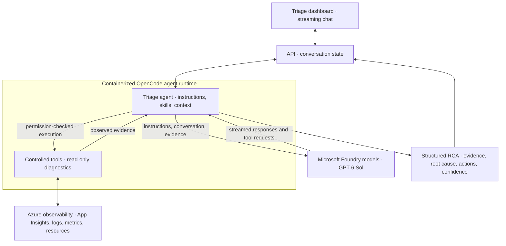

# Signal · Agentic Azure Observability

A streaming, evidence-first workspace for investigating Azure incidents, powered
by **OpenCode and Microsoft Foundry models**. The runtime calls the **GPT-6 Sol**
deployment directly through Azure OpenAI's v1 Responses API. Chat with the agent,
watch controlled diagnostic activity, and follow evidence from application
telemetry through container health and database signals.

## Quick start

Requires Docker with the Docker Compose plugin.

```bash
git clone https://github.com/Boburmirzo/triage-agent-demo.git
cd triage-agent-demo
docker compose up --build -d --wait
```

Open **http://localhost:7070**. The default demo needs no cloud credentials,
model API key, or database. Choose an example prompt and press **Send**.

| Service | Address | Responsibility |
| --- | --- | --- |
| UI | http://localhost:7070 | Chat, resource search, activity trace, evidence, Markdown export |
| API | http://localhost:7071 | Persistent conversations, run lifecycle, server-sent events |
| Runtime | Internal `http://runtime:4096` | Seeded diagnostics or the OpenCode agent |

Change host ports with `UI_PORT` and `API_PORT`. Conversation state lives in
`api-data`; OpenCode sessions live in `runtime-data`.

```bash
docker compose ps
curl http://localhost:7071/health
docker compose down
```

Stopping the stack preserves named volumes.

## Features

- Streaming Markdown chat with visible diagnostic tool activity.
- Direct Foundry inference with API-key or Microsoft Entra ID authentication.
- Visible deployment, authentication method, and per-response model attribution.
- Ordinary conversation for greetings and general questions in OpenCode mode.
- Searchable live Azure resource inventory and environment selection.
- Correlated application, container, database, and deployment diagnostics.
- Clear distinctions between observed evidence, missing telemetry, and inferred causes.
- Cancellation, reconnect/reload recovery, persistent history, and Markdown export.
- Deterministic, credential-free demo mode for presentations and experimentation.

## Architecture

```text
Browser → UI / nginx :8080 → API :8088 → Runtime :4096
                              │             ├─ demo: seeded evidence + streamed answer
                              │             └─ OpenCode :4097 ⇄ Microsoft Foundry / GPT-6 Sol
                              └─ api-data                 └─ runtime-data

                      ← SSE messages, tool activity, and state updates ←
```

### Where the model fits



**Foundry performs inference and proposes tool calls. OpenCode owns tool execution
and enforces permissions.** Tool results return to the model for correlation and
the final answer. Model deployment controls belong to Foundry; Azure read access
and tool permissions are configured separately. The supplied runtime runs in
Docker Compose; an AKS deployment is not included in this project.

The dashboard's **Microsoft Foundry** panel shows the configured deployment and
authentication method. It marks the connection verified only after an agent
response succeeds, rather than assuming that an endpoint or model catalog entry
proves inference is working. Assistant messages retain their model attribution.

```text
services/
  api/                 # Conversation persistence and run orchestration
  runtime/
    agents/            # Triage instructions
    config/            # Provider configuration and tool permissions
    plugins/           # Direct Foundry authentication and model request settings
    skills/            # Demo and live Azure investigation guidance
    tools/             # Seeded evidence and scoped Azure diagnostic helpers
    lib/               # Shared JSON/SSE transport utilities
  ui/
    public/            # Dependency-free browser UI
    nginx.conf         # Same-origin API proxy with SSE buffering disabled
tests/                 # Transport, configuration, environment, and diagnostic tests
docker-compose.yml
.env.example
```

Each browser stream starts with an authoritative snapshot and then receives
message deltas, tool updates, and session updates. The API owns execution
independently of the browser, so closing a tab does not cancel a run. **Stop**
cancels the runtime request and the corresponding OpenCode session. An API
restart marks in-flight responses interrupted; completed conversations persist.

## Use GPT-6 Sol directly from Microsoft Foundry

Deploy an Azure OpenAI model in Microsoft Foundry, then copy `.env.example` to
`.env`. Use the **resource endpoint** and your **deployment name**, which can
differ from the underlying model name.

### API-key authentication

```dotenv
TRIAGE_MODE=opencode
AZURE_OPENAI_ENDPOINT=https://your-resource.openai.azure.com
AZURE_OPENAI_DEPLOYMENT=gpt-6-sol
AZURE_OPENAI_AUTH_MODE=api-key
AZURE_OPENAI_API_KEY=your-foundry-resource-key
```

```bash
docker compose up --build -d --wait
```

The runtime normalizes the URL to
`https://your-resource.openai.azure.com/openai/v1` and sends streaming requests
directly to **`POST /openai/v1/responses`**. A Foundry resource endpoint such as
`https://your-resource.services.ai.azure.com` is also accepted. A project URL
ending in `/api/projects/...` is not a model inference endpoint.

No model gateway is required. The runtime uses `@ai-sdk/openai` with the Foundry
v1 endpoint, Azure authentication headers, streaming responses, and function calls.

### Microsoft Entra ID authentication

To use the Azure identity authenticated inside the runtime instead of a key:

```dotenv
TRIAGE_MODE=opencode
AZURE_OPENAI_ENDPOINT=https://your-resource.openai.azure.com
AZURE_OPENAI_DEPLOYMENT=gpt-6-sol
AZURE_OPENAI_AUTH_MODE=azure-cli
AZURE_OPENAI_API_KEY=
```

```bash
docker compose up -d --build --wait
docker compose exec runtime az login --use-device-code
```

The identity needs an inference role such as **Cognitive Services OpenAI User**
on the model resource. The OpenCode authentication plugin acquires an Entra token
for `https://ai.azure.com` and refreshes it before expiry, including during
multi-step investigations. Tokens stay in process memory and are not written
into generated model configuration or sent to the browser.

On an Azure host with managed identity available, set
`AZURE_LOGIN_WITH_MANAGED_IDENTITY=true` and optionally `AZURE_CLIENT_ID`.
The runtime authenticates its CLI with that identity at startup; keep
`AZURE_OPENAI_AUTH_MODE=azure-cli`. Azure observability permissions are separate
from model inference permissions.

### Model configuration

Choose deployment names and limits that match your resource:

| Variable | Default |
| --- | --- |
| `AZURE_OPENAI_ENDPOINT` | required in OpenCode mode |
| `AZURE_OPENAI_DEPLOYMENT` | `gpt-6-sol` |
| `AZURE_OPENAI_SMALL_DEPLOYMENT` | inherits the primary deployment |
| `AZURE_OPENAI_AUTH_MODE` | `api-key` or `azure-cli` |
| `OPENCODE_PROVIDER_ID` / `OPENCODE_PROVIDER_NAME` | `foundry` / `Microsoft Foundry` |
| `OPENCODE_MODEL_CONTEXT_LIMIT` | `1050000` |
| `OPENCODE_MODEL_INPUT_LIMIT` | `922000` |
| `OPENCODE_MODEL_OUTPUT_LIMIT` | `16000` |
| `OPENCODE_COMPACTION_RESERVED` | `50000` |
| `TRIAGE_RUN_TIMEOUT_MS` | `600000` |

The runtime packages OpenCode `1.18.30`; its native server listens on runtime
loopback (`4097`). GPT-6 requests use model sampling defaults instead of unsupported
temperature/top-p overrides. Recreate the runtime after environment changes;
rebuild it after changing packaged instructions, skills, plugins, or configuration.

| Demo configuration | Model inference | Evidence |
| --- | --- | --- |
| `TRIAGE_MODE=demo` | None; deterministic simulation | Seeded |
| `TRIAGE_MODE=opencode`, live Azure disabled | Direct Foundry model calls | Seeded tool output |
| `TRIAGE_MODE=opencode`, live Azure enabled | Direct Foundry model calls | Real scoped Azure diagnostics |

For a presentation, OpenCode mode with seeded evidence demonstrates real Foundry
inference and controlled tool execution without requiring access to application
resources. See the [Microsoft Foundry Responses API documentation](https://learn.microsoft.com/azure/foundry/openai/how-to/responses)
for deployment, supported-model, and authentication details.

## Connect a real Azure resource group

Set these additional values in `.env`:

```dotenv
TRIAGE_MODE=opencode
TRIAGE_LIVE_AZURE_ENABLED=true
AZURE_SUBSCRIPTION_ID=your-subscription-id
AZURE_RESOURCE_GROUP=example-observability
```

Start the stack, then authenticate the runtime:

```bash
docker compose up -d --wait
docker compose exec runtime az login --use-device-code
```

The scoped helper explicitly selects the configured subscription and resource
group for every diagnostic. The identity needs read access to the relevant
resources and telemetry, such as Reader, Monitoring Reader, and Log Analytics
Reader. CLI login state in the container must be renewed after recreation unless
you supply an Azure CLI configuration volume.

On supported Azure hosts, use `AZURE_LOGIN_WITH_MANAGED_IDENTITY=true`, optionally
`AZURE_CLIENT_ID`, and the same subscription/resource-group configuration instead.

Once connected, the UI displays real inventory counts and a **Resources** tab.
Select a resource to prepare a workload investigation. Greetings and general
questions receive normal answers; diagnostic tools run when current evidence is
requested. The Resources tab refreshes inventory independently of chat.

### Environment selection

- **Staging:** names containing `staging`, case-insensitively.
- **Production:** names containing `prod`, case-insensitively.
- **All resources:** the entire configured resource group.

Selection applies to resource search, counts, example prompts, and each chat
turn. Change it between messages to switch scope.

Shared resources are resolved through resource references or explicit mappings,
not assumed to belong exclusively to an environment. When an app's connection
details are secret references, configure confirmed PostgreSQL resource names:

```dotenv
AZURE_STAGING_DATABASE_SERVERS=example-read-replica
AZURE_PRODUCTION_DATABASE_SERVERS=example-primary-db
```

These optional mappings accept comma-separated names. Shared database metrics
are labelled server-wide rather than environment-specific.

### Diagnostic coverage

Application investigations use a correlated workload check:

1. Application Insights requests, dependencies, exceptions, and traces.
2. Related Container App state, replicas, restarts, and resource metrics.
3. Console/system logs from the app's linked Log Analytics workspace.
4. A bounded, non-following direct log tail when workspace logs are empty.
5. Resolved PostgreSQL CPU, memory, storage, connections, and diagnostic log destinations.
6. Related deployment/control-plane activity within the same UTC window.

An empty Application Insights component does not end the investigation. The
agent follows the host and available downstream signals, distinguishing name-based
candidate relationships from confirmed references. Missing exports, unavailable
signals, or inaccessible resources are reported as coverage gaps, not proof of health.

Generic metadata and available metric discovery also cover other ARM resource
types in the group. These diagnostics do not grant SQL access, Kubernetes pod
access, or access to Key Vault secrets, blob contents, or message payloads.
Log excerpts are redacted; SQL statements and request payloads are omitted.
The agent performs no remediation or resource modifications.

## Tests

Requires Node.js 22+ and Python 3. No npm dependencies are required.

```bash
npm test
npm run test:azure
```

Tests cover streaming transport, reconnection, persistence, cancellation,
conversational behavior, model configuration, environment scope, resource
relationships, log redaction, and continued checks after empty telemetry.

To exercise the packaged OpenCode binary against a deterministic mock Foundry
v1 Responses API without model credentials:

```bash
docker compose build runtime
npm run test:opencode
```

This check creates and removes its own temporary runtime container. It verifies
the direct `/openai/v1/responses` path, Azure API-key headers, model request
parameters, skill loading, a seeded tool invocation, and streamed text.

## Scope

This is a single-user demonstration workspace. The API uses a single-process
JSON store rather than shared multi-replica storage or tenant authentication.
Published host ports bind to loopback. Conversations are capped at 100 turns;
messages are limited to 16,000 characters.

Demo mode always replays a fixed incident and clearly labels simulated evidence.
OpenCode mode provides conversational analysis; live Azure results depend on
the permissions and telemetry available in the configured resource group.
